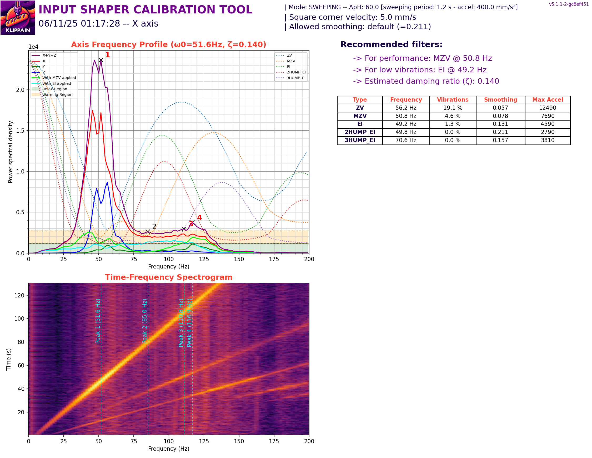

<h1 align="center">CR-10S Pro Klipper Backup</h1>

Backup of the Klipper, Moonraker, KlipperScreen and Crowsnest configuration for a Creality CR-10S Pro V2 with a Palette 2 and an ADXL345 accelerometer.

  <a href="#whats-inside">What's inside</a> ·
  <a href="#input-shaper-results">Input shaper results</a> ·
  <a href="#restoring">Restoring</a>

Klipper backup script for manual or automated GitHub backups. This backup is provided by [Klipper-Backup](https://github.com/Staubgeborener/klipper-backup).

## What's inside

Everything lives under `printer_data/config/`, mirroring the printer host's `~/printer_data/config` folder.

| File or folder | What it holds |
| --- | --- |
| [`printer.cfg`](printer_data/config/printer.cfg) | Main Klipper config: MCU, steppers, extruder, heated bed, BLTouch, screws tilt adjust, bed mesh, safe Z home, Palette 2, filament runout sensor, plus the saved calibration values |
| [`macros.cfg`](printer_data/config/macros.cfg) | G-code macros: `PRINT_START` / `PRINT_END`, `PID_TUNE_SELECT`, pause/resume/cancel, filament load/unload, adaptive bed mesh and purge, parking, and the `update_git` backup macro |
| [`palette.cfg`](printer_data/config/palette.cfg) | Palette 2 shortcut macros (connect, load, clear, cut) |
| [`adxl.cfg`](printer_data/config/adxl.cfg) | ADXL345 accelerometer, resonance tester and Shake&Tune settings, with `ADXL_X` / `ADXL_Y` macros |
| [`reshelper.cfg`](printer_data/config/reshelper.cfg) | ResHelper resonance test macros |
| [`shell_command.cfg`](printer_data/config/shell_command.cfg) | Shell-command macros for camera logs and finding the MCU serial port |
| [`timelapse.cfg`](printer_data/config/timelapse.cfg) | Moonraker-timelapse macro definitions |
| [`moonraker.conf`](printer_data/config/moonraker.conf) | Moonraker server, authorization, history, webcam and update manager (Crowsnest, Sonar, Timelapse, KlipperScreen, Fluidd, Shake&Tune, Klipper-Backup) |
| [`crowsnest.conf`](printer_data/config/crowsnest.conf) | Crowsnest webcam streamer settings |
| [`KlipperScreen.conf`](printer_data/config/KlipperScreen.conf) | KlipperScreen printer entry and a PID tune menu entry |
| [`klipper_repos.txt`](printer_data/config/klipper_repos.txt) | KIAUH custom Klipper repository list |
| [`Input_Shaper_Scripts/`](printer_data/config/Input_Shaper_Scripts) | Shell scripts that run Klipper's `calibrate_shaper.py` for the X and Y axes |
| [`RES_DATA/`](printer_data/config/RES_DATA) | ResHelper shaper calibration graph |
| [`ShakeTune_results/input_shaper/`](printer_data/config/ShakeTune_results/input_shaper) | Shake&Tune input shaper graphs |

Files such as `.env`, `secrets.conf`, CSVs and timestamped `printer-*.cfg` backups are excluded by [`.gitignore`](.gitignore).

## Input shaper results

**Shake&Tune input shaper graph, X axis**

## Restoring

Copy the contents of `printer_data/config/` back into `~/printer_data/config/` on the printer host, then restart Klipper and Moonraker. Device paths in `printer.cfg` (such as the `[mcu]` and `[palette2]` serial ports) are specific to the original host and may need updating.
